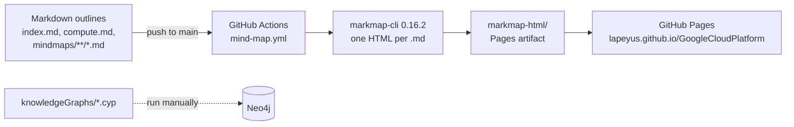

# Google Cloud Platform study maps

Personal study notes on Google Cloud, written as Markdown outlines and published as interactive
[markmap](https://markmap.js.org/) mind maps on GitHub Pages.

**Live site:** <https://lapeyus.github.io/GoogleCloudPlatform/>

## Description

This repository is a knowledge base built while studying Google Cloud (including material aimed at
the Professional Cloud Architect certification). Each topic is a Markdown outline; a GitHub Actions
workflow turns every `.md` file into a zoomable, collapsible mind map and publishes the result to
GitHub Pages. It is meant for anyone who wants a visual, hierarchical overview of GCP services and
architecture concepts.

Alongside the mind maps, the repo holds Neo4j Cypher scripts that model GCP service families as a
knowledge graph, and a set of page-by-page HTML study notes.

## Features

- **Service-family index** (`index.md`) listing GCP products grouped by family (AI and ML,
  compute, storage, networking, and more).
- **Topic mind maps** under `mindmaps/` covering resource management, billing, IAM, compute,
  containers and Kubernetes, storage and databases, the Cloud Operations suite, networking,
  generative AI and certification topics.
- **Compute decision guide** (`compute.md`) with the questions to ask when choosing between
  Compute Engine, GKE, Cloud Run, App Engine and Cloud Functions.
- **Automatic publishing**: any push that changes a `.md` file on `main` rebuilds the whole site.
- **Knowledge graph** (`knowledgeGraphs/*.cyp`): Cypher `MERGE` statements that create GCP
  service-family nodes and their services in Neo4j.

## Quick links

| Topic | Mind map |
|---|---|
| Service families (index) | [index.html](https://lapeyus.github.io/GoogleCloudPlatform/index.html) |
| Choosing a compute service | [compute.html](https://lapeyus.github.io/GoogleCloudPlatform/compute.html) |
| Resource hierarchy | [Hierarchy.html](https://lapeyus.github.io/GoogleCloudPlatform/mindmaps/resourcemanagement/Hierarchy.html) |
| Billing | [billing.html](https://lapeyus.github.io/GoogleCloudPlatform/mindmaps/resourcemanagement/billing/billing.html) |
| Interacting with GCP | [access.html](https://lapeyus.github.io/GoogleCloudPlatform/mindmaps/resourcemanagement/interactingwithgcp/access.html) |
| IAM | [iam.html](https://lapeyus.github.io/GoogleCloudPlatform/mindmaps/iam/iam.html) |
| Storage overview | [storage.html](https://lapeyus.github.io/GoogleCloudPlatform/mindmaps/storage/storage.html) |

Any other file follows the same rule: `path/to/file.md` is published at
`https://lapeyus.github.io/GoogleCloudPlatform/path/to/file.html` (spaces in file names become
`%20`).

## Architecture



The workflow (`.github/workflows/mind-map.yml`) runs on pushes to `main` that touch `**/*.md`, or
manually via `workflow_dispatch`. It installs `markmap-cli@0.16.2` on Node 20, converts every
Markdown file in the repo (keeping relative paths), and deploys the output with
`actions/deploy-pages`. The front matter in each file (`markmap: initialExpandLevel`, `maxWidth`,
`embedAssets`) controls how the map renders.

## Requirements

- Nothing to view the site: a browser is enough.
- To preview locally: Node.js 20 and `markmap-cli`.
- To load the knowledge graph: a Neo4j instance (Desktop, Aura or Docker) and `cypher-shell` or the
  Neo4j Browser.

## Quick start

Preview a single mind map locally, exactly as CI builds it:

```bash
git clone https://github.com/Lapeyus/GoogleCloudPlatform.git
cd GoogleCloudPlatform
npm install -g markmap-cli@0.16.2
markmap compute.md -o /tmp/compute.html   # opens in your browser
```

Or build the full site into a local folder:

```bash
mkdir -p markmap-html
find . -name '*.md' -not -path './.git/*' | while read -r f; do
  out="markmap-html/${f#./}"; out="${out%.md}.html"
  mkdir -p "$(dirname "$out")"
  markmap --no-open "$f" -o "$out"
done
```

## Usage

**Add or edit a topic.** Create a Markdown file anywhere in the repo (usually under `mindmaps/`).
Headings and nested bullets become branches. Optional front matter:

```yaml
---
markmap:
  initialExpandLevel: 2
  maxWidth: 300
  embedAssets: true
---
```

Push to `main` and the workflow republishes the site.

**Load the knowledge graph into Neo4j:**

```bash
cypher-shell -u neo4j -p '<password>' -f knowledgeGraphs/serviceFamilies.cyp
```

`serviceFamilies.cyp` and `AIandML.cyp` are focused models, `all.cyp` combines them, and
`draft.cyp` is a larger work-in-progress version.

## Repository structure

```text
.
├── index.md                     # GCP service families index (site home)
├── compute.md                   # how to choose a compute service
├── mindmaps/                    # topic outlines, one mind map per file
│   ├── resourcemanagement/      # hierarchy, labels, quotas, billing, access
│   ├── iam/                     # IAM, service accounts, org restrictions
│   ├── compute/                 # compute, containers, Kubernetes, Anthos migrate
│   ├── storage/                 # Cloud Storage, Cloud SQL, Spanner, Bigtable, Firestore, ...
│   ├── cloud_operations_suite/  # logging, monitoring, tracing, profiling, error reporting
│   ├── Network/                 # the Google network
│   ├── genai/                   # introduction to generative AI
│   ├── architecting/            # design and provisioning topics
│   ├── certification_PCA/ PCA/  # Professional Cloud Architect exam notes
├── knowledgeGraphs/             # Neo4j Cypher scripts (service families as a graph)
├── GCP Arquitech's guide/       # page-by-page HTML study notes + markmap exports
├── .github/workflows/
│   └── mind-map.yml             # build markmaps and deploy to GitHub Pages
└── LICENSE                      # Apache 2.0
```

## Configuration

There is no application configuration. The only settings are:

- the markmap front matter in each Markdown file;
- GitHub Pages enabled for the repository with **GitHub Actions** as the source (the workflow needs
  `pages: write` and `id-token: write`, already declared in the file).

No secrets are used.

## Tests

There are no automated tests. The CI build is the only check: if `markmap` fails on a file, the
workflow fails.

## Deployment

Automatic, through `.github/workflows/mind-map.yml` on every push to `main` that changes Markdown.
It can also be run by hand from the **Actions** tab (`workflow_dispatch`).

## Project status

**Inactive study project.** Most work happened between March and April 2024; the last commit is
from October 2024 (adding the HTML study notes). The live site still responds.

### Known limitations

- In `index.md`, most entries in the service-family lists are placeholders that all point to the
  same compute mind map; only a few topics have dedicated maps.
- Some older links in `index.md` (for example `mindmaps/billing/billing.html`) point to paths that
  no longer exist and return 404; the working paths are the ones in the table above.
- The `GCP Arquitech's guide/` folder is plain HTML: the workflow only publishes the HTML that
  markmap builds from Markdown, so this folder is not part of the live site.
- `mindmaps/.DS_Store` is committed by mistake.

## License

Apache License 2.0. See [LICENSE](LICENSE).
